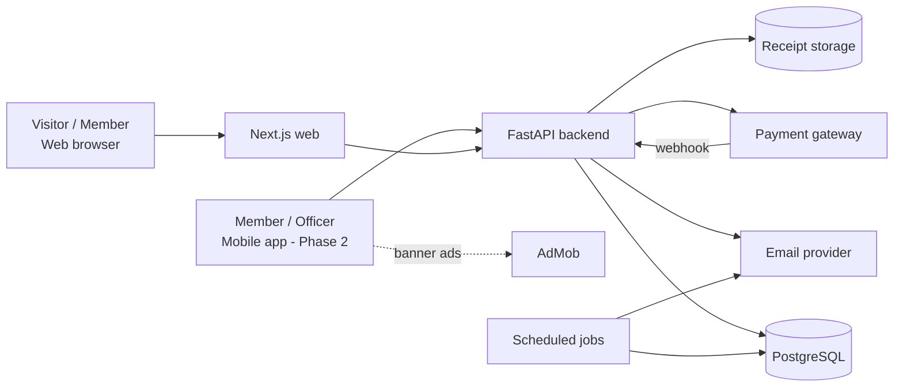
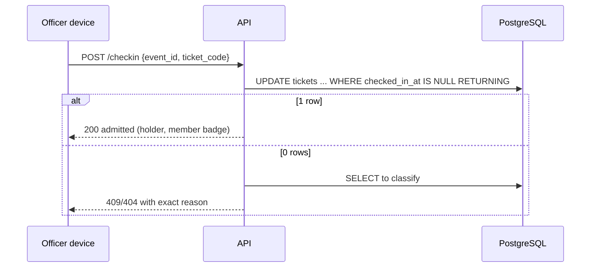
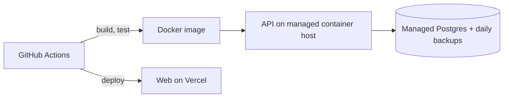

# 03 — Architecture

## 1. System context


## 2. Components
| Component | Responsibility | Never does |
|---|---|---|
| Web (Next.js) | Public site, member and officer screens, ticket QR, door check-in (responsive) | Computes prices or roles |
| Mobile (Expo) | Member tickets, shop, announcements, officer check-in, banner ads | Shows ads on check-in, payment or finance screens |
| API (FastAPI) | Auth, validation, business rules, transactions, webhooks | Stores card data |
| PostgreSQL | System of record, constraints, seat-limit trigger, reporting views | Holds files |
| Payment gateway | Collects online payments on its hosted page | — |
| Email provider | Sends announcements, magic links, renewal reminders, tickets | — |
| Receipt storage | Stores expense receipts privately | — |
| Jobs | Reservation cleanup, renewal reminders | Hold business rules not in services |

## 3. Backend layers
```
api/           HTTP routers, request/response schemas, auth dependencies
services/      Business rules and transactions (one function = one use case)
repositories/  SQL access, no business rules
models/        SQLAlchemy tables mirroring schema.sql
schemas/       Pydantic request/response models
core/          config, security, errors, logging, request_id
jobs/          CLI entrypoints for scheduled work
```
Dependency direction: `api → services → repositories → models`. Services may call other services; repositories never call services.

## 4. Key flows

### 4.1 Buy tickets
```mermaid
sequenceDiagram
    participant B as Buyer (web/mobile)
    participant A as API
    participant D as PostgreSQL
    participant G as Gateway
    B->>A: POST /tickets/purchase (holders, Idempotency-Key)
    A->>D: BEGIN; cleanup expired; lock ticket_type; check seats
    A->>D: INSERT tickets (reserved, price per holder)
    A->>G: create gateway order (total)
    A-->>B: 201 reserved tickets + gateway order
    B->>G: pay on hosted page
    G->>A: webhook payment succeeded (signed)
    A->>D: INSERT payments; SET tickets.payment_id
    A-->>B: ticket email with QR link
```

### 4.2 Door check-in


### 4.3 Announcement
Officer posts → row saved → web list updates immediately → email job queued for every `members.email` → retries on failure.

### 4.4 Expense and reimbursement
Volunteer uploads receipt via signed URL → submits expense (`submitted`) → treasurer approves → treasurer reimburses (`reimbursed_at` set) → balance changes.

## 5. Deployment (proposed, `D-013`)

Two environments with separate databases and secrets: staging and production. Production deploys are triggered by a version tag and require approval.

## 6. Cross-cutting concerns
- **Auth:** passwordless email magic link, short-lived signed token, 24 h session (`09_SECURITY.md`).
- **Authorization:** role derived on each request from `leadership_roles` for the current year.
- **Observability:** request ID on every log line and error body; Sentry for exceptions; uptime check on `/health`.
- **Idempotency:** `Idempotency-Key` on purchase and order creation; webhook processed by target state and `external_ref`.
- **Time:** UTC everywhere; the UI formats to `Asia/Kolkata`.
