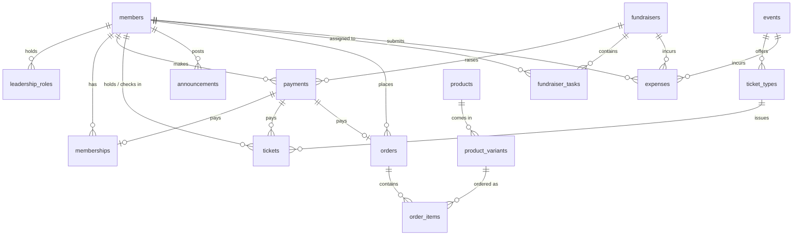

# 04 — Data Model

**Source of truth:** `database/schema.sql` (PostgreSQL 16). This document explains it; if they disagree, the SQL wins and this file gets fixed. After migration `0001` exists, all changes go through Alembic.

## 1. Entity relationship diagram

## 2. Tables
| Table | Purpose | Key columns and rules | Requirements |
|---|---|---|---|
| `members` | Everyone who signs up; also the mailing list | `email` unique on `LOWER(email)`; `joined_on` | MEM-1, ANN-2 |
| `leadership_roles` | Elected team per year | unique `(member_id, position, term_year)` | MEM-6 |
| `memberships` | One paid period of membership | `valid_from < valid_until`; `payment_id` NULL = unpaid; `renewal_reminder_sent_at` | MEM-2, MEM-3 |
| `payments` | **Every rupee in** | `category` in dues/ticket/merchandise/fundraiser; `amount > 0`; `method` cash/online; `fundraiser_id` set iff category is fundraiser | TRS-1 |
| `events` | Events such as the Spring Gala | `starts_at` | TIX-1 |
| `ticket_types` | Prices and seats for an event | `member_price`, `non_member_price` ≥ 0; `seat_limit > 0`; unique `(event_id, name)` | TIX-1, TIX-4 |
| `tickets` | One row per seat sold or reserved | `ticket_code` UUID unique; `price_paid`; `payment_id`; `checked_in_at`, `checked_in_by`; seat-limit trigger | TIX-2…6 |
| `announcements` | Record of what was said and when | `posted_by`, `posted_at` | ANN-1, ANN-3 |
| `products` | Merchandise items | `price`, `member_price` | MER-1 |
| `product_variants` | Sizes and stock | unique `(product_id, size)`; `stock_quantity ≥ 0` | MER-1, MER-4 |
| `orders` | A member's merch order | `status` placed/paid/cancelled; `payment_id` | MER-2, MER-3 |
| `order_items` | Lines of an order | PK `(order_id, variant_id)`; `quantity > 0`; `unit_price` | MER-2 |
| `fundraisers` | Bake sale and similar | `goal_amount` optional | FUN-1 |
| `fundraiser_tasks` | Who does what | `status` todo/in_progress/done; `assigned_to`; `due_date` | FUN-2 |
| `expenses` | Money out | `status` submitted/approved/reimbursed/rejected; `reimbursed_at` set iff reimbursed; `receipt_url`; optional `event_id`, `fundraiser_id` | TRS-2, TRS-3 |

## 3. Views (read models)
| View | Answers |
|---|---|
| `active_members` | Is this person a member today? (MEM-4) |
| `memberships_due_for_renewal` | Who needs a reminder: expiring within 30 days, none sent (MEM-3) |
| `ticket_availability` | Seats sold and left per ticket type (TIX-4) |
| `event_summary` | Tickets sold, attended, revenue per event (TIX-7) |
| `fundraiser_progress` | Tasks done vs total, amount raised vs goal (FUN-3) |
| `treasurer_summary` | Money in by category and reimbursed money out (TRS-1, TRS-4) |
| `club_balance` | One number: in − out (TRS-4) |

## 4. State machines
| Thing | States and transitions |
|---|---|
| Membership | unpaid (`payment_id` NULL) → paid → expired by date (no stored status) |
| Ticket | reserved (`payment_id` NULL, `price_paid > 0`) → valid → checked in. Free ticket (`price_paid = 0`) is valid immediately. Expired reservations are deleted. |
| Order | `placed → paid`, `placed → cancelled` |
| Expense | `submitted → approved → reimbursed`, `submitted → rejected` |
| Task | `todo → in_progress → done` (may move back) |

## 5. Invariants the database already enforces
- No duplicate member emails (case-insensitive).
- No negative prices, stock, or amounts; seat limit and quantities positive.
- A payment is linked to a fundraiser if and only if its category is `fundraiser`.
- An expense has `reimbursed_at` if and only if its status is `reimbursed`.
- Tickets cannot exceed `seat_limit` (trigger, serialised by a row lock).
- Deleting an order cascades to its items; deleting a fundraiser cascades to its tasks. Everything else is restricted.

## 6. Invariants the application must enforce
- A payment's `category` matches what it pays (dues ↔ membership, ticket ↔ tickets, merchandise ↔ order).
- A ticket's `price_paid` equals the price rule in `02_TRD.md` §3.2 at purchase time.
- `payments.amount` equals the sum of what it pays for.
- Lowering `seat_limit` below tickets already sold is rejected.
- Financial rows are never deleted through the API (the only deletions are expired unpaid reservations).

## 7. Known limitations of the current schema
1. **Zero-dues memberships** would show as inactive in `active_members`, because activity requires a payment and `payments.amount > 0`. Dues are expected to be above zero (`D-019`).
2. **Reservations and `event_summary`:** the view counts every ticket row, so unpaid reservations inflate `tickets_sold` and `ticket_revenue` until they expire (verified). Fix proposed below.
3. **No gateway reference** on `payments`, so reconciling with the gateway statement is manual. Fix proposed below.
4. **No opening balance:** history before go-live must be imported as dated payments and expenses, or the ledger starts fresh (`05_DATA_SOURCE.md`).
5. **No per-recipient email log** for announcements.
6. **Renewal view includes unpaid memberships:** `memberships_due_for_renewal` does not check `payment_id`, so a never-paid membership expiring soon would also get a "renewal" reminder. Fix proposed below (verified on PostgreSQL 16: an unpaid membership is listed).

## 8. Proposed changes (not applied; need acceptance in `15_DECISIONS.md`)
| ID | Change | Why |
|---|---|---|
| D-020 | `ALTER TABLE payments ADD COLUMN external_ref TEXT UNIQUE;` | Idempotent webhooks, reconciliation against the gateway statement |
| D-021 | (a) Recreate `event_summary` counting only valid tickets (`t.payment_id IS NOT NULL OR t.price_paid = 0` in the join). (b) Add `ms.payment_id IS NOT NULL` to `memberships_due_for_renewal`. | (a) Correct sold, attended, revenue figures: verified that one unpaid reservation currently adds its price to revenue. (b) Remind only paid members to renew |

Keep `ticket_availability` as is: reservations **must** count against seats.

## 9. Migration policy
- `0001_baseline` runs `database/schema.sql`.
- Each later change is one Alembic revision with an `upgrade` and a `downgrade`.
- CI builds an empty database from migrations on every pull request.
- Production migrations run before the new API version starts, and must be backward compatible with the previous version for one release.
