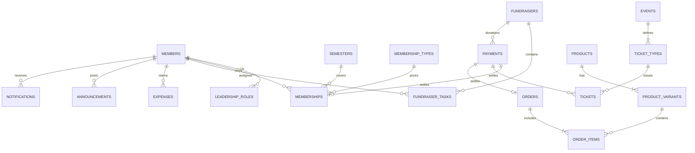

# Skyline Student Association — Complete System & Platform Guide (A to Z)

> **Platform**: Skyline Student Association Unified Management System  
> **Problem Statement**: Student Organization System — Build one system to run events, members, and money in one place  
> **Target Audience**: Campus Leaders, Club Officers, Treasurers, Software Developers, and Evaluators  
> **Stack**: FastAPI (Python 3.13), React 18 + Vite (TypeScript), PostgreSQL 16, Redis 7, MinIO, Razorpay, Tailwind CSS v4, Docker Compose  
> **Last updated**: 11 Oct 2026. This guide describes what is built and running, and it is the source of truth next to `WEBSITE_STATUS.md` (change log) and `ISSUES.md` (issue history).

---

## Table of Contents

1. [Executive Summary & Problem Statement Alignment](#1-executive-summary--problem-statement-alignment)
2. [A Semester With the Club: Scene-by-Scene Solutions](#2-a-semester-with-the-club-scene-by-scene-solutions)
3. [Full-Stack Architecture & System Topology](#3-full-stack-architecture--system-topology)
4. [Role-Based Access Control (RBAC) Matrix](#4-role-based-access-control-rbac-matrix)
5. [Database Schema & Data Models (PostgreSQL)](#5-database-schema--data-models-postgresql)
6. [Core System Modules & Feature Walkthrough](#6-core-system-modules--feature-walkthrough)
   - 6.1 Authentication, Identity & Security
   - 6.2 Dashboard & Live Sync
   - 6.3 Membership
   - 6.4 Events and Tickets
   - 6.5 Merchandise
   - 6.6 Announcements
   - 6.7 Fundraisers
   - 6.8 Treasury and Reports
   - 6.9 Administration
   - 6.10 Payments
7. [Real-Time WebSocket & Offline Check-In Protocol](#7-real-time-websocket--offline-check-in-protocol)
8. [REST API Reference](#8-rest-api-reference-generated-from-the-running-server)
9. [Setup, Demo Data & Tests](#9-setup-demo-data--tests)
10. [Resilience & Production Notes](#10-resilience--production-notes)

---

## 1. Executive Summary & Problem Statement Alignment

### 1.1 The Challenge
Running a vibrant student organization on a modern university campus is inherently chaotic. The leadership team rotates every academic year, volunteers balance coursework with club tasks, new members join on a rolling monthly basis, and revenue streams are scattered across dues, event door sales, merchandise pre-orders, and fundraisers.

Without dedicated infrastructure, club administration quickly deteriorates:
- **Disjointed spreadsheets** lead to lost contacts, untracked dues, and disputes over membership discounts.
- **Cash boxes at event doors** invite missing money, long entry lines, and zero attendee intelligence.
- **Physical paper receipts and personal messaging apps** result in volunteer reimbursements falling through the cracks.
- **WhatsApp group proliferation** fragments critical announcements, drowning out meeting updates.

The **Skyline Student Association Platform** is built from the ground up as a single, unified digital backbone that consolidates **events, members, and money** into an integrated, reactive web and mobile-responsive application.

### 1.2 Legacy friction vs. what the platform does

| Area | Before | Now |
| :--- | :--- | :--- |
| **Member sign-ups** | A spreadsheet; dues cross-checked by hand; expiries unnoticed. | Self-serve sign-up with an emailed code, semester-based membership with Razorpay or cash, an Active/Pending status, and renewal reminders 30 and 7 days before the semester ends. |
| **Event tickets** | Cash at the door and a printed list. | Online booking with member and non-member prices, seat and per-person limits, PDF tickets with a signed QR, phone booking from a poster QR, and an offline door scanner that shows member status. |
| **Club budget** | A notebook. | Finance and Reports: dues, tickets, merchandise and donations in; reimbursed expenses out; balance; eight reports exportable as CSV, Excel and PDF. |
| **Announcements** | Typed into many WhatsApp groups. | One post by an Admin or Officer reaches every member in-app and by email, and stays in a dated archive. |
| **Volunteer expenses** | Receipts chased for weeks. | Members submit expenses with a receipt; the Treasurer approves and marks them reimbursed. |
| **Merchandise** | Paper order forms. | Shop with pictures (uploaded or designed in the studio), sizes with live stock, checkout and Razorpay payment, per-person limits, atomic stock handling. |
| **Fundraisers** | Checklists in someone's head. | Fundraisers with a goal, tasks with an assignee, status and due date, and an On track / At risk / Behind badge. |

---

## 2. A Semester With the Club: Scene-by-Scene Solutions

### Scene 1: A new student joins
1. The student signs up with a `gmail.com` or `student.edu.in` address (optionally a student ID) and enters the code emailed to them.
2. In **Membership** they pick the semester and type and pay with Razorpay, or an officer records cash in **Finance > Awaiting payment** ("Mark cash received").
3. Their dashboard shows Active with the valid-until date; member prices apply to tickets and merchandise.
4. Before the semester ends they get a notification, an email and a Google Calendar link; the Membership tab also offers an `.ics` file.
5. At the door the scanner shows "Member (type, valid until)" or "Not a member".

### Scene 2: Selling tickets for the spring gala
1. An Officer creates the event with ticket types: a description, member and non-member prices, total seats, non-member seats, per-person caps. Prices and descriptions can be edited later.
2. People book online (or from the phone after scanning the event's poster QR) and pay with Razorpay; unpaid seats are held for 15 minutes.
3. The ticket downloads as a PDF with a signed QR that only the club's check-in understands. After paying, holders also see the organiser's registration form link as a button and QR.
4. On the night the door scans with a phone camera or types the 8-character code, online or offline, and duplicates are refused.
5. Reports show seats sold, attended, no-shows, revenue and profit per event.

### Scene 3: Announcing the next meeting
An Admin or Officer posts once in **Announcements**; every member gets a notification (and an email if chosen), and the post stays in the archive with author and time.

### Scene 4: Ordering hoodies
Staff add a product with sizes and stock, or design it in the studio. Members open the product, press Add to cart or Buy now, review the lines and pay online, or reserve for 15 minutes. Row locks make sure the last hoodie is never sold twice; stock per size is always visible.

### Scene 5: Planning a fundraiser
An Officer creates the fundraiser with a goal and date, adds tasks (bake, buy supplies, run the table) and assigns each to a member. Assignees move tasks through To do, In progress and Done. Every fundraiser shows tasks done, money raised against the goal and an On track / At risk / Behind badge.

### Scene 6: The treasurer closes the books
**Finance** and **Reports** show what came in (dues, tickets, merchandise, donations), what went out (reimbursed expenses), and what is left. The eight reports can be filtered by date and exported as CSV, Excel or PDF with the club logo and watermark.

---

## 3. Full-Stack Architecture & System Topology

The system is constructed with a decoupled, high-performance architecture emphasizing sub-second reactivity, strict data consistency, and offline resilience.

```
┌────────────────────────────────────────────────────────────────────────┐
│                        CLIENT / BROWSER TIER                           │
│  React 18 + Vite SPA  │  Tailwind CSS  │  PWA Service Worker & Cache   │
│  WebCam jsQR Scanner  │  Zustand/Context  │  WebSocket Client Hook     │
└───────────────────▲────────────────────────────────▲───────────────────┘
                    │ HTTPS REST                     │ WSS Pub/Sub
                    ▼                                ▼
┌────────────────────────────────────────────────────────────────────────┐
│                        API & BACKEND TIER                              │
│                    FastAPI (ASGI / Python 3.11+)                       │
│  ┌─────────────────────────┐  ┌─────────────────────────────────────┐  │
│  │   REST API Controllers  │  │  WebSocket Real-Time Broadcast Hub  │  │
│  │   Auth, Events, Members │  │  Asyncio Lifespan Workers           │  │
│  │   Shop, Finance, Tasks  │  │  (Ticket Holds, SMTP Outbound Mail) │  │
│  └────────────┬────────────┘  └──────────────────┬──────────────────┘  │
└───────────────┼──────────────────────────────────┼─────────────────────┘
                │ SQLAlchemy ORM                   │ Redis Pub/Sub
                ▼                                  ▼
┌───────────────────────────────┐  ┌─────────────────────────────────────┐
│       POSTGRESQL 16 DB        │  │           REDIS 7 IN-MEMORY         │
│  Relational Storage, Row-Lock │  │  Pub/Sub Event Bus, Token Cache     │
│  Double-Entry Ledger Records  │  │  15-Min Ticket Hold Expirations     │
└───────────────────────────────┘  └─────────────────────────────────────┘
```

### 3.1 Frontend Architecture
* **Framework**: React 18 + TypeScript with Vite, Tailwind v4, TT Firs Neue typography, white plain surfaces with hairline dividers (no card boxes), purple `#714B67` accents.
* **Installable PWA**: manifest, icons and a shell-caching service worker; "Add to home screen" on phones.
* **Data and live updates**: one API client (`apiClient.ts`); every successful write broadcasts a topic over the WebSocket and open panels refetch through `useLiveRefresh`, so there are no manual reloads.
* **Offline door check-in**: IndexedDB attendee list plus a queue of scans that syncs through `/checkin/batch` when the connection returns.
* **Modals** (profile, product, checkout) are rendered into `document.body` so they always open centred in the viewport.
* **Inputs**: money fields accept only digits and one decimal point; counts accept digits only (`numeric.ts`), and the server rejects anything else with 422.

### 3.2 Backend Architecture
* **Engine**: FastAPI (async) on Python 3.13, SQLAlchemy 2 + asyncpg, PostgreSQL 16, Redis 7 (rate limits, OTP codes, pub/sub, Razorpay order binding), MinIO for pictures.
* **Auth**: PBKDF2 passwords, JWT as bearer token and httpOnly cookie, emailed one-time codes. Sign-up always needs an emailed code; Google sign-in only works for accounts that already exist.
* **Background work** (started from the app lifespan): release of unpaid 15-minute holds, the email worker (primary Gmail mailbox with a second as backup, branded HTML with the logo), and the daily membership/event reminder job.
* **Storage**: product pictures and designs live in MinIO only. The API serves them at `/api/v1/media/...` and generates a 480 px WebP thumbnail on upload. If MinIO is down the upload fails with a 503; nothing is silently written elsewhere.
* **Required settings** (no silent defaults): `JWT_SECRET`, `TICKET_SIGNING_SECRET` (separate key for ticket QR signatures), MinIO keys, SMTP and Razorpay keys. See `.env.example`.

---

## 4. Role-Based Access Control (RBAC) Matrix

The server resolves one access level per person on every request (`AuthService.resolve_access_level`): **Admin > Treasurer (also Accountant) > Officer > Member > Guest**. The browser only chooses which tabs to draw; every endpoint re-checks.

* **Admin**: everything, plus assigning Officer/Treasurer roles, seeing every user, force-deleting events.
* **Treasurer / Accountant**: Finance, expense approvals, cash received, Reports.
* **Officer**: events, tickets and check-in, shop and merchandise design, announcements, members, fundraisers, Finance (cash), Reports.
* **Member**: member prices, own tickets/orders/membership, reminders.
* **Guest**: public events and shop at non-member prices, membership purchase.

| Feature / Action | Admin | Treasurer | Officer | Member | Guest |
| :--- | :---: | :---: | :---: | :---: | :---: |
| Dashboard | Club-wide | Club-wide | Club-wide | Personal | Personal |
| Assign roles, see all users | Yes | No | No | No | No |
| Create / edit / delete events, edit ticket prices and limits | Yes | No | Yes | No | No |
| Delete an event that already has issued tickets | Yes (voids them) | No | No | No | No |
| Buy tickets | Yes | Yes | Yes | Member price | Guest price |
| Check in tickets, door member check | Yes | No | Yes | No | No |
| Create / design / delete merchandise | Yes | No | Yes | No | No |
| Order merchandise | Yes | Yes | Yes | Member price | Guest price |
| Post announcements | Yes | No | Yes | No | No |
| Manage fundraisers and assign tasks | Yes | No | Yes | Own tasks (status) | No |
| Approve expenses, mark cash received, treasury | Yes | Yes | Cash only | No | No |
| Submit expenses | Yes | Yes | Yes | Yes | No |
| Reports (8) with CSV / Excel / PDF | Yes | Yes | Yes | No | No |

---

## 5. Database Schema & Data Models (PostgreSQL)

Created from `database/schema.sql` (plus idempotent additions in `backend/scripts/bootstrap.py`). Money is `NUMERIC(10,2)`; constraints and triggers enforce seat limits, non-member merchandise limits and a single active semester range (`EXCLUDE USING gist`).



### 5.1 Tables and the columns that matter
* **members**: name, unique email, phone, `student_id`, `password_hash`, `joined_on`.
* **leadership_roles**: member, position (Admin, Officer, Treasurer, ...), term year. This is the only source of staff roles.
* **semesters** (non-overlapping date ranges), **membership_types** (editable tiers with dues), **memberships** (member + semester + type + dues snapshot + `payment_id`). A membership is active only when it has a payment and today falls inside its semester. An unpaid attempt can be retried and never confers member status.
* **payments**: category (`dues`, `ticket`, `merchandise`, `fundraiser`), amount, method (`cash`, `online`), external Razorpay reference (unique, makes webhooks idempotent).
* **events**: title, description, venue, `starts_at`, optional `form_url` (registration link shown after payment). **ticket_types**: name, description, member and non-member price, total seats, non-member seats, per-member and per-guest caps (editable after creation).
* **tickets**: holder, price paid, `payment_id`, UUID `ticket_code`, `checked_in_at/by`. The QR carries `SKYLINE1.<code>.<HMAC>`.
* **products** (price, member price, non-member limit, per-person caps, `image_url`, `is_active`), **product_variants** (size + stock), **orders** (`placed`, `paid`, `cancelled`; the total is the sum of `order_items`), **order_items**.
* **announcements**, **notifications** (per member, de-duplicated), **fundraisers**, **fundraiser_tasks** (`todo`, `in_progress`, `done`, assignee, due date), **expenses** (`submitted`, `approved`, `reimbursed`, `rejected`, receipt, optional event or fundraiser).
* Hot-path indexes cover ticket lookups by member/email/payment, payments by date and member, orders by status, announcements and events by date.
* The treasury is a single-entry in/out view over `payments` and `expenses`, not a double-entry ledger.

---

## 6. Core System Modules & Feature Walkthrough

### 6.1 Authentication, Identity & Security
* Sign-up needs a code emailed to the address (students: `gmail.com`, `student.edu.in`; staff: `company.com`, `company.in`, configurable). The first verified staff-domain sign-up becomes Admin; everyone else starts as Guest until an Admin assigns a role.
* Sign-in by password or emailed code. Codes are only sent to addresses that can use them (no mail to unknown inboxes), at most one per minute and three per 15 minutes per address.
* Google sign-in works only for existing accounts and is verified server-side against the configured client ID.
* The role is always re-read from `/auth/me`; nothing role-related is trusted from browser storage.

### 6.2 Dashboard & Live Sync
Club-wide KPIs, sales/visits trends and rankings for staff; personal spending, attendance and membership status for members and guests. A "Live Sync" badge shows the WebSocket state. Notifications arrive in a bell with an unread count and optional desktop alerts.

### 6.3 Membership
Choose semester and type, pay with Razorpay, or have an officer record cash. Pending memberships show a "Pay now" button. Renewal reminders go out 30 and 7 days before the semester ends by notification, email and a Google Calendar link (plus an `.ics` file). The door check shows whether the ticket holder is a paid member.

### 6.4 Events and Tickets
Ticket types have descriptions, member and non-member prices, seat and per-person limits (all editable by staff afterwards). Past events are read-only. Tickets download as PDF with a signed QR; unpaid reservations are held for 15 minutes. Each event has a poster QR that opens the event page on a phone for booking. After payment a ticket holder sees the organiser's registration link as a button and QR. Staff can delete an event (blocked while paid tickets exist, unless an Admin forces it).

### 6.5 Merchandise
Staff upload a picture or design in the studio (T-shirt, hoodie, tote; colour; draggable text and logos on front and back; print positions; white-background removal; transparent export). Pictures go to MinIO with an automatic thumbnail. Shop cards show the whole product. Checkout: review the lines, then pay online (Razorpay) or reserve for 15 minutes. Stock is decremented atomically with row locks; per-person limits are enforced on the server. Deleting a product removes it, or hides it if orders exist.

### 6.6 Announcements
Admin and Officer post once; every member gets an in-app notification and, optionally, an email. Every post is kept with author and time.

### 6.7 Fundraisers
Goal vs raised, task list with assignee picker, status and due dates, and an On track / At risk / Behind badge on every fundraiser without opening it.

### 6.8 Treasury and Reports
Dues, tickets, merchandise and donations in; approved and reimbursed expenses out; balance. Eight reports (profit per event, raised vs expenses, money in/out, membership and dues, merchandise sales and stock, volunteer expenses, seats filled and attendance, who still owes what) with date filters and CSV, Excel and PDF export (logo header and watermark on the PDF).

### 6.9 Administration
Admin tab: assign Officer/Treasurer roles, see every user with their membership, tickets, orders and totals paid, run reminders on demand.

### 6.10 Payments
Razorpay orders are created server-side from database prices; the verify step checks the signature, that the order matches what it was created for, and the amount, then records the payment and activates the membership, tickets or order. A failed or cancelled checkout never shows success and never grants anything. A signed `/webhooks/razorpay` settles payments even if the tab was closed.

---

## 7. Real-Time WebSocket & Offline Check-In Protocol

### 7.1 Live updates
```
[Browser] <── WebSocket /ws/updates ──> [FastAPI] <── Redis pub/sub ──> [other API processes]
```
Every successful write publishes a topic: `events`, `shop`, `finance`, `members`, `announcements`, `fundraisers`, `dashboard`, `notifications`. Open panels subscribe with `useLiveRefresh([...topics], reload)` and refetch, so numbers, stock and notifications change without a reload. If Redis is unreachable the API falls back to in-process delivery so a single server keeps working.

### 7.2 Offline-resilient check-in
1. **Manifest download**: with the check-in panel open online, the app stores the event's attendee list (code, signed payload, holder, ticket type, checked-in flag, member status) in IndexedDB.
2. **Offline validation**: a scanned QR (`SKYLINE1.<ticket_code>.<hmac>`) or typed 8-character code is checked against that list; the door screen shows Member or Not a member.
3. **Queue and sync**: accepted scans are queued with timestamps and sent in one `POST /checkin/batch` when the connection returns. Each scan is validated independently, conflicts are listed.

---

## 8. REST API Reference (generated from the running server)

Base path `/api/v1`. Everything except the public reads (events, products, announcements, fundraisers, stats, sign-up rules) needs a signed-in session; staff-only routes answer 403 to other roles. The live, always-current reference is the interactive documentation at `http://localhost:8000/docs`.

### Admin

| Method | Endpoint | What it does |
| :--- | :--- | :--- |
| `POST` | `/api/v1/admin/run-reminders` | Run the renewal + event reminder sweep immediately (it also runs every day on its own). |
| `GET` | `/api/v1/admin/users` | Everything the admin needs to know about every user: roles, membership, student id, activity. |

### Announcements

| Method | Endpoint | What it does |
| :--- | :--- | :--- |
| `GET` | `/api/v1/announcements` | Public list of club announcements. |
| `POST` | `/api/v1/announcements` | Officer creates an announcement and broadcasts emails to members. |
| `GET` | `/api/v1/announcements/{announcement_id}` | Get single announcement details. |

### Auth

| Method | Endpoint | What it does |
| :--- | :--- | :--- |
| `GET` | `/api/v1/auth/check-email` | Check if an email is already registered in the system. |
| `POST` | `/api/v1/auth/google` | Verify a Google ID token on the server and sign the user in. |
| `POST` | `/api/v1/auth/login` | Email + password sign-in. Role and access level always come from the database. |
| `POST` | `/api/v1/auth/logout` | Clear session cookie. |
| `POST` | `/api/v1/auth/magic-link` | Request a 15-minute magic login link. |
| `GET` | `/api/v1/auth/me` | Return profile, current roles, and active membership status. |
| `POST` | `/api/v1/auth/otp/generate` | Generate a 6-digit OTP code for instant login verification. |
| `POST` | `/api/v1/auth/otp/verify` | Verify 6-digit OTP and issue authenticated session token. |
| `POST` | `/api/v1/auth/password` | Change Password |
| `POST` | `/api/v1/auth/register` | Create an account. Everyone starts as a Guest; staff roles are granted by an Admin. |
| `POST` | `/api/v1/auth/register-otp` | Register student account with 6-digit OTP verification. |
| `GET` | `/api/v1/auth/signup-rules` | Which email domains may create an account (shown on the sign-up form). |
| `GET` | `/api/v1/auth/testmail-otp` | Development helper: read the latest OTP from testmail.app (TESTMAIL_API_KEY / TESTMAIL_NAMESPACE in .env). |
| `POST` | `/api/v1/auth/token` | Exchange single-use magic token for a 24h JWT session. |

### Dashboard

| Method | Endpoint | What it does |
| :--- | :--- | :--- |
| `GET` | `/api/v1/dashboard/summary` | Live KPI cards, chart series and rankings. Staff see the whole club; everyone else sees their own activity. |

### Events & Tickets

| Method | Endpoint | What it does |
| :--- | :--- | :--- |
| `POST` | `/api/v1/checkin` | Door check-in: scan QR or manual code entry. |
| `POST` | `/api/v1/checkin/batch` | Replay scans that were captured offline; each is validated independently. |
| `GET` | `/api/v1/events` | Public list of events and ticket availability. |
| `POST` | `/api/v1/events` | Officer creates an event with ticket types. |
| `DELETE` | `/api/v1/events/{event_id}` | Remove an event. Refused while paid tickets exist unless an Admin passes force=true (paid tickets are then voi |
| `GET` | `/api/v1/events/{event_id}` | Public event detail and seats remaining. |
| `GET` | `/api/v1/events/{event_id}/form` | Event Form |
| `PATCH` | `/api/v1/events/{event_id}/form` | Admin/officer pastes a Google Form (or any) link that ticket holders see, as a QR and a button, after paying. |
| `GET` | `/api/v1/events/{event_id}/form-qr.png` | Event Form Qr |
| `GET` | `/api/v1/events/{event_id}/manifest` | Signed attendee manifest so door staff can keep checking people in while offline. |
| `GET` | `/api/v1/events/{event_id}/qr.png` | Poster QR for an event. Scanning it on a phone opens the event page on the website, where tickets can be booke |
| `GET` | `/api/v1/events/{event_id}/summary` | Officer summary of tickets sold, attendees, and revenue. |
| `POST` | `/api/v1/events/{event_id}/ticket-types` | Officer adds a ticket type with total and non-member seat limits. |
| `GET` | `/api/v1/me/tickets` | Return all tickets held by the logged-in member. |
| `PATCH` | `/api/v1/ticket-types/{ticket_type_id}` | Admin/officer edits a ticket type's description and prices after creation. |
| `PATCH` | `/api/v1/ticket-types/{ticket_type_id}/limits` | Admin/officer sets how many tickets one member / one non-member may hold (null removes the cap). |
| `POST` | `/api/v1/tickets/purchase` | Buy or hold tickets for members and non-members. |
| `GET` | `/api/v1/tickets/{ticket_code}/pdf` | Printable PDF ticket containing the signed Skyline QR code. |
| `GET` | `/api/v1/tickets/{ticket_code}/qr.png` | Ticket Qr Png |

### Finance & Treasurer

| Method | Endpoint | What it does |
| :--- | :--- | :--- |
| `GET` | `/api/v1/expenses` | List expenses (filtered by user if not officer). |
| `POST` | `/api/v1/expenses` | Volunteer submits receipt for reimbursement. |
| `POST` | `/api/v1/expenses/receipt` | Store a receipt and return its URL for the expense form. Server-side size and type limits apply. |
| `PATCH` | `/api/v1/expenses/{expense_id}` | Officer or Treasurer reviews and approves/reimburses expense. Nobody approves their own. |
| `POST` | `/api/v1/payments/cash` | Officer records cash payment for dues, tickets, merchandise, or fundraisers. |
| `GET` | `/api/v1/payments/pending` | Everything that has been requested but not paid yet (memberships, shop orders, tickets). |
| `GET` | `/api/v1/payments/razorpay/config` | Returns the Razorpay public Key ID loaded strictly from server environment. |
| `POST` | `/api/v1/payments/razorpay/order` | Creates a cryptographic Razorpay Order after verifying ticket/membership amount in DB. |
| `POST` | `/api/v1/payments/razorpay/verify` | Verifies HMAC SHA256 payment signature and activates membership/tickets immediately. |
| `GET` | `/api/v1/treasurer/balance` | Treasurer report: Total in, total out, and balance. |
| `GET` | `/api/v1/treasurer/summary` | Treasurer report: Money in by category and reimbursed expenses out. |

### Fundraisers

| Method | Endpoint | What it does |
| :--- | :--- | :--- |
| `GET` | `/api/v1/fundraisers` | Public list of fundraisers. |
| `POST` | `/api/v1/fundraisers` | Officer creates a fundraiser event/campaign. |
| `GET` | `/api/v1/fundraisers/{fundraiser_id}` | Get fundraiser details. |
| `GET` | `/api/v1/fundraisers/{fundraiser_id}/progress` | Tasks done vs total, money raised vs goal. |
| `GET` | `/api/v1/fundraisers/{fundraiser_id}/tasks` | List volunteer tasks for a fundraiser. |
| `POST` | `/api/v1/fundraisers/{fundraiser_id}/tasks` | Officer creates a volunteer task. |
| `PATCH` | `/api/v1/fundraisers/{fundraiser_id}/tasks/{task_id}` | Assignee updates task status; officer can update all task fields. |

### Members

| Method | Endpoint | What it does |
| :--- | :--- | :--- |
| `GET` | `/api/v1/leadership` | List leadership roles for the year. |
| `POST` | `/api/v1/leadership` | Admin assigns a position (Officer, Treasurer, ...) to a member. |
| `DELETE` | `/api/v1/leadership/{leadership_role_id}` | Admin removes a position. |
| `GET` | `/api/v1/members` | Officer search for members. |
| `POST` | `/api/v1/members` | Self sign-up or officer creation of a new member. |
| `GET` | `/api/v1/members/lookup` | Fast door lookup to verify active membership. |
| `GET` | `/api/v1/members/{member_id}` | Self or Officer view member profile. |
| `PATCH` | `/api/v1/members/{member_id}` | Self or Officer update name and phone. |
| `GET` | `/api/v1/members/{member_id}/memberships` | Self or Officer view membership history. |
| `GET` | `/api/v1/membership-types` | List membership types. |
| `POST` | `/api/v1/membership-types` | Officer creates a new membership type. |
| `PATCH` | `/api/v1/membership-types/{type_id}` | Officer updates a membership type. |
| `POST` | `/api/v1/memberships` | Member selects semester and type to buy (or officer creates for them). |
| `GET` | `/api/v1/semesters` | List all semesters. |
| `POST` | `/api/v1/semesters` | Officer creates a new semester. |

### Merchandise & Shop

| Method | Endpoint | What it does |
| :--- | :--- | :--- |
| `GET` | `/api/v1/me/orders` | List orders placed by the current member. |
| `GET` | `/api/v1/orders` | Officer list orders. |
| `POST` | `/api/v1/orders` | Place a goodie order for members or non-members. |
| `GET` | `/api/v1/orders/{order_id}` | Order detail (buyer or staff only). |
| `POST` | `/api/v1/orders/{order_id}/cancel` | Cancel a placed order and return stock (buyer or staff only). |
| `GET` | `/api/v1/products` | Public merchandise list with sizes and non-member limits. |
| `POST` | `/api/v1/products` | Officer creates a goodie product. |
| `POST` | `/api/v1/products/image` | Admin/officer uploads a merchandise picture or an exported design; the URL goes into the product form. |
| `DELETE` | `/api/v1/products/{product_id}` | Admin/officer removes a product. With no orders it is deleted; otherwise it is hidden so order history stays i |
| `GET` | `/api/v1/products/{product_id}` | Public product detail. |
| `PATCH` | `/api/v1/products/{product_id}/image` | Admin/officer attaches or replaces a product picture (URL returned by /products/image). |
| `PATCH` | `/api/v1/products/{product_id}/limits` | Admin/officer sets how many units one member / one non-member may order (null removes the cap). |
| `POST` | `/api/v1/products/{product_id}/variants` | Officer adds or updates stock for a size variant. |

### Notifications

| Method | Endpoint | What it does |
| :--- | :--- | :--- |
| `GET` | `/api/v1/memberships/{membership_id}/calendar.ics` | Calendar file (Google Calendar, Apple, Outlook) with a renewal reminder 30 and 7 days before the semester ends |
| `GET` | `/api/v1/notifications` | My Notifications |
| `POST` | `/api/v1/notifications/read` | Mark Read |

### Online payments

| Method | Endpoint | What it does |
| :--- | :--- | :--- |
| `POST` | `/api/v1/webhooks/razorpay` | Razorpay Webhook |

### Reports

| Method | Endpoint | What it does |
| :--- | :--- | :--- |
| `GET` | `/api/v1/reports` | List Reports |
| `GET` | `/api/v1/reports/{key}` | Run Report |

### Reports & Renewals

| Method | Endpoint | What it does |
| :--- | :--- | :--- |
| `GET` | `/api/v1/events/{event_id}/report` | Attendance versus tickets sold, and what the event made: ticket revenue minus approved expenses. |
| `GET` | `/api/v1/fundraisers/{fundraiser_id}/report` | Raised versus goal, spending and profit for one fundraiser. |
| `POST` | `/api/v1/members/import` | One-off import of the existing sign-up spreadsheet. Existing emails are skipped, bad rows are reported. |
| `POST` | `/api/v1/memberships/renew` | Renew into the next semester the member does not hold yet, reusing their latest membership type. |

### System

| Method | Endpoint | What it does |
| :--- | :--- | :--- |
| `GET` | `/api/v1/config` | Get Config |
| `GET` | `/api/v1/health` | Health |
| `GET` | `/api/v1/ready` | Ready |
| `GET` | `/api/v1/stats` | Real, public club numbers for the marketing/sign-in screens. |
| `GET` | `/config` | Get Config |
| `GET` | `/health` | Health |
| `GET` | `/ready` | Ready |
| `GET` | `/stats` | Real, public club numbers for the marketing/sign-in screens. |

### Webhooks

| Method | Endpoint | What it does |
| :--- | :--- | :--- |
| `POST` | `/api/v1/webhooks/payment` | Payment gateway webhook (idempotent via external_ref). |

---

## 9. Setup, Demo Data & Tests

### 9.1 Run it locally
```bash
docker compose up -d                    # PostgreSQL, Redis and MinIO (Docker Desktop must be running)
cd backend
cp ../.env.example .env                 # then fill in the keys (see below)
pip install -r requirements.txt
python -m scripts.bootstrap             # creates tables/indexes and the first Admin (ADMIN_EMAIL / ADMIN_PASSWORD)
python -m uvicorn app.main:app --port 8000
cd ../frontend && npm install && npm run dev      # http://localhost:3000
```
Keys you must set in `backend/.env`: `JWT_SECRET`, `TICKET_SIGNING_SECRET`, `MINIO_*`, `SMTP_*` (Gmail needs an App Password; port 465 works when 587 is blocked), `RAZORPAY_*`, `FRONTEND_URL` (use your LAN IP so phones can open event QR codes), `GOOGLE_CLIENT_ID` (sign-in for existing accounts) and `VITE_GOOGLE_CLIENT_ID` in `frontend/.env`. If Docker was closed, start Docker Desktop and run `docker compose up -d` again; data is kept in named volumes.

### 9.2 Accounts
Only the first Admin exists on a clean install. Staff sign up with a staff-domain address and an emailed code; the Admin then assigns Officer and Treasurer from Dashboard > Admin. There are no seeded role logins and no shared passwords.

### 9.3 Demo club (optional)
```bash
python -m scripts.seed_demo             # adds 18 members (cannot sign in), 4 events with tickets, 5 merchandise items with pictures,
                                        # 10 orders, announcements, 2 fundraisers with tasks, 7 expenses
python -m scripts.seed_demo --remove    # removes exactly those rows (ids kept in scripts/.demo_ids.json)
```
It only adds rows, never changes yours. Take a `pg_dump` first if you want a restore point.

### 9.4 Tests
```bash
cd backend && python -m pytest -q       # 44 tests against an isolated skyline_test database and Redis db 1
```
They cover sign-up rules and the mandatory code, role resolution, ticket QR/PDF and check-in, seat and per-person limits, event and product deletion, ticket price edits, report exports, checkout, concurrent oversell races, hold expiry, reminders and email delivery (to a local sink; tests never send real mail). Frontend: `npx tsc --noEmit -p frontend`.

---

## 10. Resilience & Production Notes

### 10.1 Built in
* **No oversell**: row locks (`SELECT ... FOR UPDATE`) and triggers on seats and non-member merchandise limits.
* **Payments**: server-side prices, signature check, order/amount binding, idempotent webhook; a cancelled or failed checkout grants nothing and can be retried.
* **Door**: offline manifest plus signed QR, batch sync, duplicate-entry refusal.
* **Holds**: abandoned reservations are released after 15 minutes.
* **No silent fallbacks**: picture storage, ticket-signing key and failing panels all report errors instead of substituting something else. Kept deliberately: the second mailbox for email and the in-process live-update relay.

### 10.1b Security controls in place
PBKDF2-SHA256 at 600,000 rounds; JWT with a mandatory strong secret outside development; httpOnly, SameSite and (in production) Secure cookies; code and login rate limits; per-role checks on every route; signed ticket QR and Razorpay signatures compared in constant time; upload type and size limits; parameterised queries; security response headers; API docs disabled in production; database, object storage and console bound to 127.0.0.1 (Redis is password-protected but still published on all interfaces on Windows). Codes are echoed in API responses only to a developer on the same machine in development.

### 10.2 Before going live
1. Use new random `JWT_SECRET` and `TICKET_SIGNING_SECRET`, change the Admin password and the MinIO and database passwords, and rotate any key that was shared in chat.
2. Run behind HTTPS (the phone camera scanner needs it) and set `APP_ENV=production` so development helpers (dev codes in responses) are off.
3. Switch Razorpay to live keys and register the webhook `<api>/api/v1/webhooks/razorpay`.
4. Back up PostgreSQL and the MinIO bucket regularly.
5. Optional: wrap the PWA with Capacitor or a TWA for the app stores; add web-push for alerts while the browser is closed.
