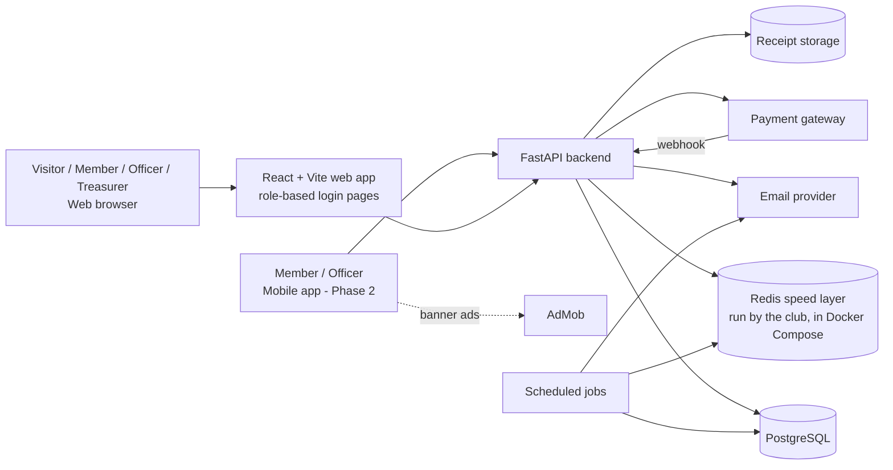
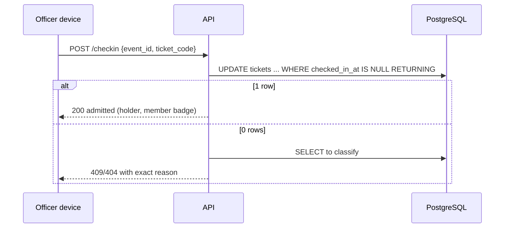
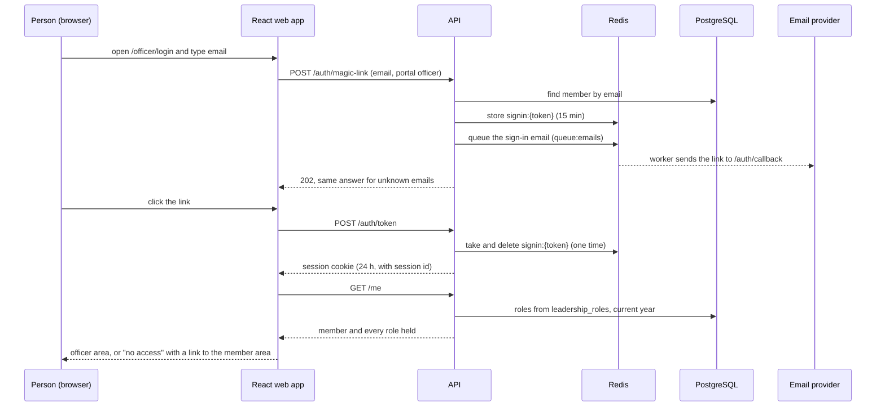
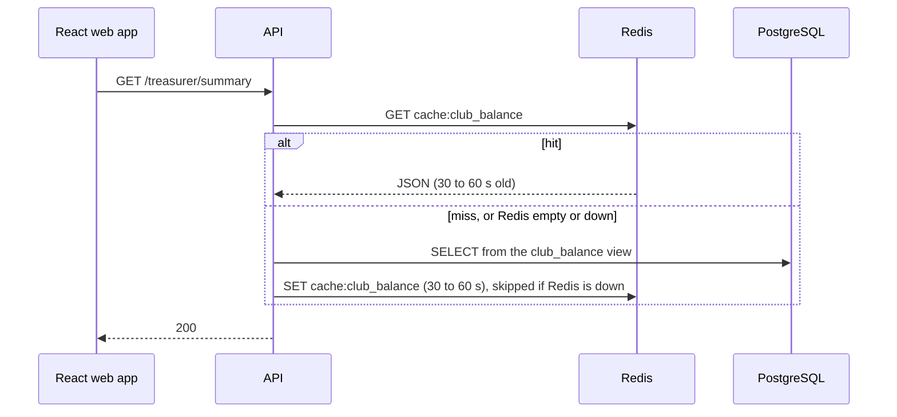
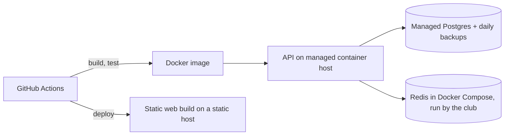

# 03 — Architecture

## 1. System context


## 2. Components
| Component | Responsibility | Never does |
|---|---|---|
| Web (React + Vite) | Public site, three role-based login pages, member, officer and treasurer screens, route guards, ticket QR, door check-in (responsive) | Computes prices or roles, or treats a hidden screen as protection |
| Mobile (Expo) | Member tickets, shop, announcements, officer check-in, banner ads | Shows ads on check-in, payment or finance screens |
| API (FastAPI) | Auth, validation, business rules, transactions, webhooks | Stores card data |
| PostgreSQL | System of record, constraints, seat-limit and non-member goodie-limit triggers, reporting views | Holds files |
| Redis | Speed layer only, run by the club in Docker Compose: 30 to 60 s report copies, rate-limit counters, one-time sign-in links, the email queue | Holds the only copy of anything, holds seats, or decides a sale, a payment, a check-in or a role |
| Payment gateway | Collects online payments on its hosted page | — |
| Email provider | Sends announcements, magic links, renewal reminders, tickets | — |
| Receipt storage | Stores expense receipts privately | — |
| Jobs | Release unpaid holds (never a paid ticket), renewal reminders (queued), the email worker that sends queued emails with retries | Hold business rules not in services |

## 3. Backend layers
```
api/           HTTP routers, request/response schemas, auth dependencies
services/      Business rules and transactions (one function = one use case)
repositories/  SQL access, no business rules
models/        SQLAlchemy tables mirroring schema.sql
schemas/       Pydantic request/response models
core/          config, security (roles, require_role), errors, logging, request_id, cache (Redis helpers)
jobs/          CLI entrypoints for scheduled work
```
Dependency direction: `api → services → repositories → models`. Services may call other services; repositories never call services.

## 4. Key flows

### 4.1 Buy tickets
```mermaid
sequenceDiagram
    participant B as Buyer (web/mobile)
    participant A as API
    participant D as PostgreSQL
    participant G as Gateway
    B->>A: POST /tickets/purchase (holders, Idempotency-Key)
    A->>D: BEGIN; cleanup expired; lock ticket_type; check seats left and non-member seats left
    A->>D: INSERT tickets (reserved, price per holder: member or non-member)
    A->>G: create gateway order (total)
    A-->>B: 201 reserved tickets + gateway order
    B->>G: pay on hosted page
    G->>A: webhook payment succeeded (signed)
    A->>D: INSERT payments; SET tickets.payment_id
    A-->>B: ticket QR email queued (queue:emails) and sent by the worker
```

A holder who is not an active member is a non-member ticket (`member_id` empty). It needs a seat in the total and a seat inside `non_member_seat_limit`; otherwise the API answers `SOLD_OUT_NON_MEMBER` (`D-025`).

Seat holds live in PostgreSQL only: an unpaid ticket row, kept for 15 minutes and released by the scheduled job, which never touches a paid ticket. Redis is not used for seat holds, so the last seat is always decided in one locked database step.

If the gateway confirms after the hold was released, the webhook locks the ticket type and checks the seat again in the database. If it is still free, the ticket is marked paid. If it is gone, the buyer is refunded and told (`02_TRD.md` §3.7).

### 4.1a Order goodies (hoodies, T-shirts)
```mermaid
sequenceDiagram
    participant B as Buyer (member or non-member)
    participant A as API
    participant D as PostgreSQL
    participant G as Gateway
    B->>A: POST /orders (items, buyer name and email if not signed in, Idempotency-Key)
    A->>D: BEGIN; cleanup expired; lock product; check stock
    A->>D: Non-member only: count non-member units on placed and paid orders, refuse past non_member_limit
    A->>D: INSERT order (placed, 15 min hold) and items
    A->>G: create gateway order (total)
    A-->>B: 201 order + gateway order
    G->>A: webhook payment succeeded (signed)
    A->>D: INSERT payments; order paid
```
Non-member units are handed out first come, first served: the earlier order takes the units while the product row is locked, and a later order gets `NON_MEMBER_LIMIT_REACHED`. An unpaid order that expires gives its units back (`D-026`).

### 4.2 Door check-in


### 4.3 Announcement
Officer posts → row saved → web list updates immediately → email job queued for every `members.email` → retries on failure.

### 4.4 Expense and reimbursement
Volunteer uploads receipt via signed URL → submits expense (`submitted`) → treasurer approves → treasurer reimburses (`reimbursed_at` set) → balance changes.

### 4.5 Sign in on a role page

Sign-out clears the session cookie. The session itself is stateless and ends at its 24 h expiry; in an emergency rotate `JWT_SECRET` to sign everyone out. Reading roles from PostgreSQL on every request means removing an officer takes effect on their next click.

### 4.6 Cached report read

The same pattern serves `ticket_availability`, `active_members` and `fundraiser_progress`. Confirming a payment or checking in a ticket deletes the four `cache:` keys after the transaction commits. The purchase never reads this cache (`02_TRD.md` §3.11).

### 4.7 Queued emails
The API puts the email on `queue:emails` and replies at once. A worker takes it off the queue and sends it; a failed send is retried, up to 3 attempts, then logged as `email_failed`. Renewal reminders, announcement emails, ticket QR emails and sign-in link emails all use it. A lost queue entry loses a pending email, never a record (`02_TRD.md` §3.11).

## 5. Deployment (proposed, `D-013`)

The web app is a static Vite build: the host must send unknown paths to `index.html` so `/officer/login` and other deep links work, and the API must sit on the same site as the web app (for example `api.club.example.org` beside `club.example.org`) so the session cookie works.
Two environments with separate databases, Redis instances and secrets: staging and production. Production deploys are triggered by a version tag and require approval.

## 6. Cross-cutting concerns
- **Auth:** passwordless email magic link, one-time via Redis, three role-based login pages, 24 h stateless session (sign-out clears the cookie) (`09_SECURITY.md`).
- **Authorization (RBAC):** role derived on each request from `leadership_roles` for the current year; Treasurer includes Officer includes Member. The API enforces it on every endpoint; the web route guards only hide screens.
- **Redis:** a speed layer only, with four jobs: 30 to 60 s report copies, rate limits, one-time sign-in links and the email queue. PostgreSQL stays the single source of truth, seat holds included, and nothing in Redis is the only copy of anything (`02_TRD.md` §3.11).
- **Observability:** request ID on every log line and error body; Sentry for exceptions; uptime check on `/health`.
- **Idempotency:** `Idempotency-Key` on purchase and order creation (where results are stored is open, and not in Redis: `D-028`); webhook processed by target state and `external_ref` in PostgreSQL.
- **Time:** UTC everywhere; the UI formats to `Asia/Kolkata`.
